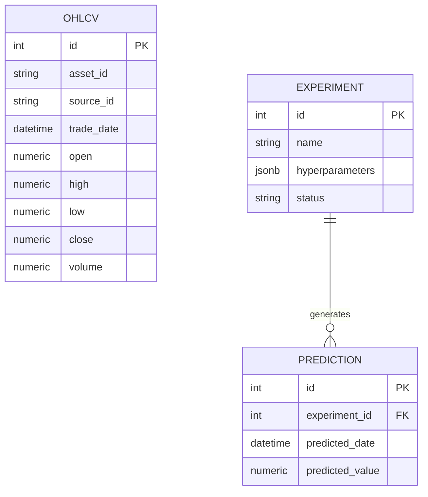
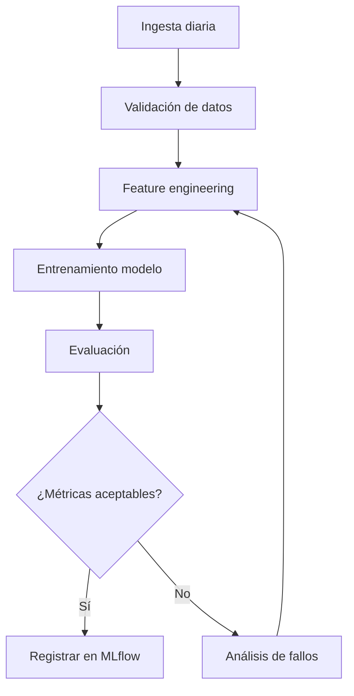

# S-15 · Documentación técnica y diagramas

## Cuándo usarla
Al documentar decisiones de diseño, arquitectura y flujos del sistema.

## Herramientas
- **Markdown**: Documentación
- **Mermaid**: Diagramas como código
  - `flowchart`: Flujos
  - `sequenceDiagram`: Secuencias
  - `classDiagram`: Clases
  - `erDiagram`: Entidad-relación
  - `stateDiagram`: Estados
  - `journey`: Viajes de usuario

## Receta

### Un diagrama por decisión relevante
- Diagramas versionados junto al código
- Si cambia el diseño, se actualizan los diagramas en la misma tarea (DoD)

### Validar siempre
- Usar `tools/validate_mermaid.py` para validar sintaxis
- Revisar a ojo al menos los diagramas más grandes

### Sintaxis segura
- Etiquetas entre comillas
- Sin `;` en `sequenceDiagram`
- Relaciones `incluye/extiende` como texto del nodo si desordenan el layout

### Ejemplos

#### Diagrama ER

#### Diagrama de flujo

## Errores típicos
- ❌ Diagramas desactualizados (no actualizarlos cuando cambia el código)
- ❌ No validar sintaxis Mermaid
- ❌ Diagramas sin etiquetas ni descripción
- ❌ Usar imágenes binarias en vez de diagramas como código

## Checklist
- [ ] Diagrama ER de la base de datos
- [ ] Diagrama de flujo de ingesta y entrenamiento
- [ ] Diagrama de secuencia de predicción
- [ ] Diagramas validados con herramienta
- [ ] Diagramas versionados junto al código
