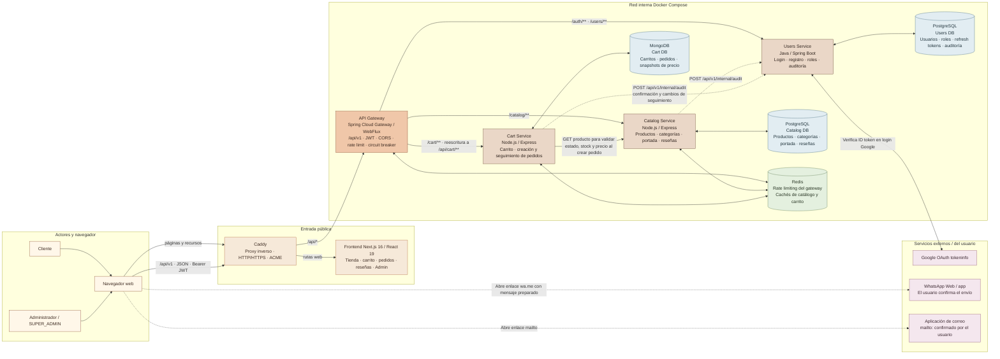

# Arquitectura de software — MAI Repostería

Diagrama lógico de la tienda según la implementación del proyecto. El archivo editable de diagrams.net está en [`arquitectura-software.drawio`](./arquitectura-software.drawio).

## Vista textual

## Rutas representativas por servicio

| Servicio | Rutas y operaciones principales |
|---|---|
| Users Service | `POST /auth/login`, `/auth/google`, `/auth/refresh`, `/auth/logout`; `POST /users/register`; `GET /users/me`; `PATCH` y `DELETE /users/admin-role`; `GET /users/audit`; `POST /internal/audit` |
| Catalog Service | `GET/PATCH /catalog/storefront`; CRUD de `/catalog/categories` y `/catalog/products`; `GET /catalog/reviews/summary`; `GET/POST /catalog/reviews/products/:productId`; `GET/PATCH /catalog/reviews/admin` |
| Cart Service | `GET /cart`; `POST /cart/items`; `PATCH/DELETE /cart/items/:productId`; `GET /cart/order-config`; `POST /cart/orders`; consulta `/orders/mine` y `/orders/:ticket/preview`; administración `/orders/:ticket/admin`, `/confirm` y `/tracking` |

## Recorridos importantes

### Catálogo

`Navegador → Caddy → Frontend → Caddy → API Gateway → Catalog Service → Redis (si hay caché) / PostgreSQL → respuesta al navegador`.

Las lecturas públicas de productos, categorías, portada y reseñas aprobadas no requieren iniciar sesión. Las escrituras administrativas requieren token de acceso y rol ADMIN o SUPER_ADMIN.

### Autenticación

`Frontend → Caddy → API Gateway → Users Service → PostgreSQL de usuarios → respuesta con tokens → Frontend`.

El frontend adjunta el access token como `Authorization: Bearer ...` a las solicitudes posteriores. Gateway valida los tokens de acceso en rutas protegidas; los servicios también validan token/rol para autorizar sus operaciones. En login Google, Users Service verifica el ID token con el endpoint `tokeninfo` de Google.

### Pedido

`Frontend → Gateway → Cart Service → MongoDB (carrito) → Catalog Service (validar cada producto) → PostgreSQL de catálogo → Cart Service → MongoDB (pedido y snapshot) → Frontend`.

El pedido queda con ticket `MAI-...`, precios copiados al momento de la compra y estado inicial `PENDING_CONFIRMATION`. Al completar el pedido se marca el carrito como ordenado y se invalida su caché. El navegador prepara el mensaje para WhatsApp; el cliente decide si lo envía. La ruta pública de seguimiento devuelve una proyección sin nombre, teléfono ni dirección.

### Administración y auditoría

El panel usa las mismas APIs. Catalog Service envía auditoría por cambios administrativos y moderación de reseñas; Cart Service la envía al confirmar pedidos y editar su seguimiento. Users Service guarda los eventos en PostgreSQL. La consulta de auditoría está restringida a SUPER_ADMIN.

## Notas para interpretar el diseño

- Caddy enruta `/api/*` al gateway y las demás rutas al frontend.
- El gateway enruta por prefijo y, para el carrito, reescribe `/api/v1/cart/...` a `/api/cart/...`.
- Las bases de datos tienen un servicio propietario cada una; el frontend no accede directamente a ellas.
- Redis apoya el rate limiting del gateway y las cachés. Catálogo y carrito contemplan seguir trabajando con su almacén principal si Redis no está disponible.
- El proyecto valida precio, estado activo y stock consultando catálogo al crear el pedido; en ese flujo no se observa una operación que descuente inventario.
- Contacto usa `mailto:` y WhatsApp mediante enlaces abiertos desde el navegador; no se representa un servidor de correo o envío automático de WhatsApp porque no están implementados como servicios backend.
- Logs técnicos y métricas son observabilidad transversal de los servicios; las acciones administrativas persistidas son la auditoría de Users Service.
